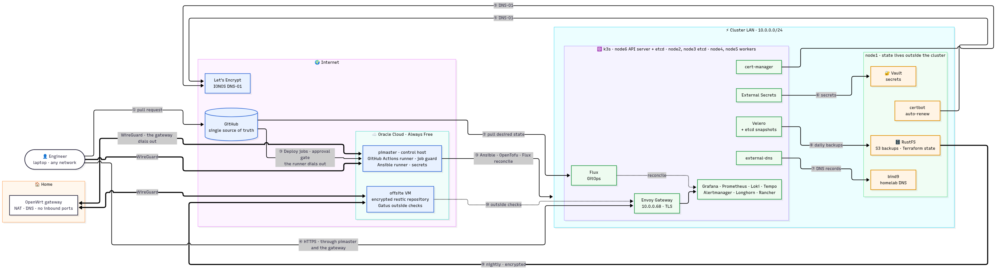

[](https://github.com/yekvitka/pi-cluster/actions/workflows/ci.yml)

**A production-grade Kubernetes platform on Raspberry Pis.** GitOps from end to end, TLS everywhere, secrets in Vault, encrypted offsite backups, monitored from outside. Every component is declared in this repository and the whole platform can be rebuilt from it.

## First principles

- **Constraints:** 4 GB ARM boards, consumer Ethernet, SD cards that wear out, a dynamic home IP, no money for cloud.
- **Goal:** operate it like a real platform: declarative, reproducible, observable, recoverable.
- **Rule:** if it is not in Git, it does not exist. Flux pulls the desired state and the cluster converges to it; nobody applies changes by hand.

## Architecture

<a href="docs/diagrams/architecture.mmd"></a>

<sub>Source: <a href="docs/diagrams/architecture.mmd">docs/diagrams/architecture.mmd</a>, rendered by <code>scripts/render-diagrams.sh</code> (an image, so it also shows in GitHub Mobile).</sub>

1. **Change = pull request.** Infrastructure, apps, versions and policies all change through Git; Renovate proposes the upgrades.
2. **Flux pulls, the cluster converges.** GitHub-hosted CI holds no credentials; drift is reverted.
3. **Deploys run on the control host.** pimaster runs in Oracle Cloud and reaches the cluster LAN through the gateway's WireGuard tunnel. Its self-hosted GitHub Actions runner dials out to GitHub and runs the [Deploy workflow](docs/runbooks/github-actions-runner.md): a Flux reconcile on every merge, OpenTofu and Ansible only after approval. A guard on the host lets nothing else run there, which matters in a public repository. Ansible logs in as `ansible` with sudo; no node accepts root SSH.
4. **One entry point.** Envoy Gateway serves every web UI on 10.0.0.68 with a wildcard certificate; UIs without their own login get basic auth at the gateway. From anywhere, the laptop reaches it over WireGuard through pimaster.
5. **Certificates renew themselves.** cert-manager in the cluster, certbot on node1 for Vault, RustFS and the router: DNS-01, so no port is ever opened.
6. **Secrets never touch Git.** External Secrets reads them from Vault at runtime.
7. **DNS follows the cluster.** external-dns writes records for new routes into bind9.
8. **Backups are automatic.** Velero (resources and volumes) daily, etcd every 12 hours, all into RustFS.
9. **And they leave the house encrypted.** Nightly restic copy to the offsite VM through WireGuard; the VM never sees the key.
10. **Watched from outside.** Gatus checks the core services and every certificate from the cloud, so an outage at home is still noticed.

## By the numbers

| | |
|---|---|
| Hardware | 7 × Raspberry Pi 4 (6 servers + OpenWrt router), USB SSDs replacing SD cards, one switch |
| Kubernetes | k3s 1.36, 5 nodes, 20 ARM cores, 22.6 GiB RAM, 1 API server, 3 etcd members |
| Workloads | 93 pods, 22 Helm releases, 37 Flux Kustomizations |
| Security | 4 auto-renewed Let's Encrypt certificates, 11 secrets synced from Vault, no root SSH on any node |
| Resilience | 3 copies of the data, 1 offsite and encrypted, Vault snapshotted nightly; about 1 hour from `make clean` to a ready cluster |
| Exposure | 0 ports open at home: the router dials out to the cloud; the Oracle VMs accept WireGuard only |
| Monitoring | 6 checks from outside (core services and every certificate), Prometheus inside |
| Cloud bill | €0 (Oracle Always Free: control host and offsite VM) |

## Stack

| Layer | Tools |
|---|---|
| Provisioning | cloud-init, Ansible (in a container), OpenTofu |
| GitOps | Flux (flux-operator), Renovate, system-upgrade-controller |
| CI/CD | GitHub Actions: checks on hosted runners, the Deploy workflow on a guarded self-hosted runner with approval gates |
| Network | Cilium (eBPF, no kube-proxy), kube-vip, Envoy Gateway, external-dns, OpenWrt, WireGuard |
| Security | cert-manager, certbot, Vault, External Secrets |
| Storage | Longhorn (SSD nodes), RustFS (S3) |
| Resilience | Velero, k3s etcd snapshots, restic offsite, Vault Raft snapshots |
| Observability | Prometheus, Grafana, Alertmanager, Loki, Fluent Bit, Tempo, OpenTelemetry, Hubble, Gatus |
| Management | Rancher |

## Design decisions

| Decision | Why |
|---|---|
| State lives outside the cluster (Vault, RustFS, DNS on node1) | The cluster is disposable: rebuild it without losing secrets or backups |
| Pull-based GitOps | The cluster converges to Git; no credentials flow into it |
| No inbound ports at home | Dynamic IP and fewer attack surfaces: DNS-01 certificates, outbound WireGuard |
| Encrypt before it leaves the house | The offsite provider holds only ciphertext |
| One pod per service | 4 GB per node: resilience comes from fast rebuilds and backups, not replicas |
| Measure, then decide | Rancher adds about 700 MB to every API server, so it runs only once the 8 GB node is the single API server |

## Status

- [Cluster 2.0](docs/plans/cluster-2.0.md), done 2026-11-06: the 8 GB node is the only API server, two 4 GB nodes are etcd-only, and Rancher, Loki and Tempo fit. Istio was removed: the 8 GB node has no CPU left for it.
- [Control host in Oracle Cloud](docs/plans/control-host-oci.md), done 2026-11-10: pimaster moved to an Oracle VM, and the cluster was rebuilt from it with a non-root Ansible user ([times](docs/backup-and-recovery.md#full-rebuild)).
- [Cluster 3.0](docs/plans/cluster-3.0.md), in progress: the repository a team would sign off on.

## Use it

Fork the repository, set your domain, email and node MAC addresses in a handful of files, enter one API key, run `make init`: [Quick start](docs/quick-start.md). Secrets are generated on your control host and in Vault, never committed.

## Repository

```
metal/            OS images: Raspberry Pi cloud-init, OpenWrt gateway
ansible/          hosts, external services, k3s, backups, certificates
kubernetes/       Flux entry points (clusters/) and apps (platform/, catalog in its README)
terraform/        RustFS, Vault, Oracle Cloud (OpenTofu)
ansible-runner/   containerized toolchain
dev/              local k3d cluster
boilerplate/      template for new Flux apps
docs/             architecture details, runbooks, plans
```

```shell
make help      # every operation
make init      # build from scratch: docs/quick-start.md
```

## Docs

- [Hardware and network](docs/hardware-and-network.md): hosts, IP plan, storage
- [Platform](docs/platform.md): sizing, web UIs, known limits
- [Backup and recovery](docs/backup-and-recovery.md)
- [Certificates](docs/certificates.md)
- [Offsite: Oracle Cloud VM](docs/offsite.md) (optional)
- [Quick start: your own cluster](docs/quick-start.md)
- [Control host](docs/control-host.md): the Oracle VM, remote access, access to the hosts
- [Runbook: node to SSD boot](docs/runbooks/node-ssd-migration.md)
- [Runbook: Deploy workflow and self-hosted runner](docs/runbooks/github-actions-runner.md): CD from master
- [Cluster 2.0](docs/plans/cluster-2.0.md)
- [Cluster 3.0](docs/plans/cluster-3.0.md): the repository a team would sign off on
- [Control host in Oracle Cloud](docs/plans/control-host-oci.md): pimaster on an Oracle VM, Ansible as a non-root user, rebuild in place

## Credits

Built on [ricsanfre/pi-cluster](https://github.com/ricsanfre/pi-cluster), whose [documentation](https://picluster.ricsanfre.com) explains each component in depth. MIT, see [LICENSE](LICENSE).
