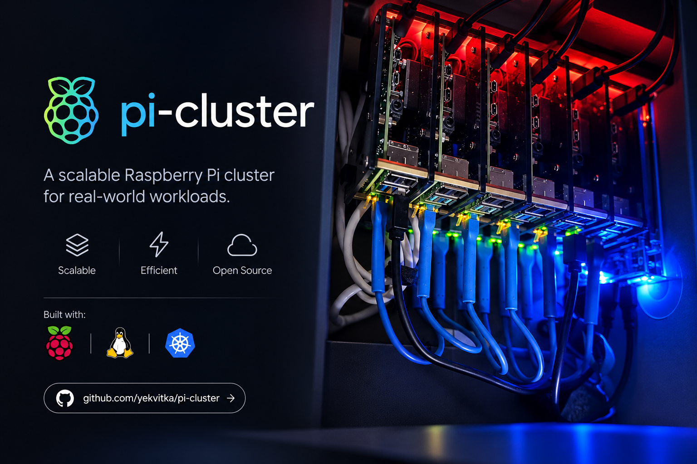
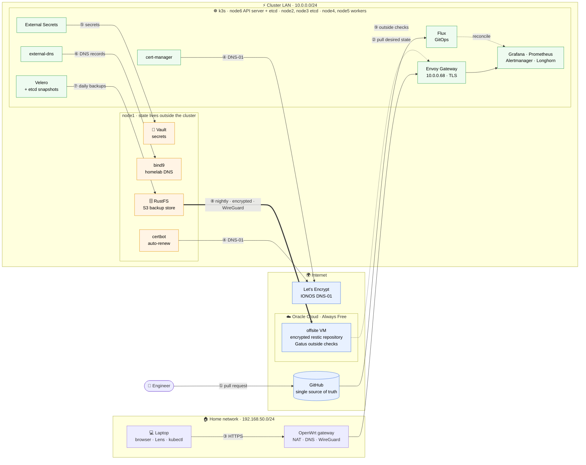

**A production-grade Kubernetes platform on Raspberry Pis.** GitOps from end to end, TLS everywhere, secrets in Vault, encrypted offsite backups, monitored from outside. Every component is declared in this repository and the whole platform can be rebuilt from it.

## First principles

- **Constraints:** 4 GB ARM boards, consumer Ethernet, SD cards that wear out, a dynamic home IP, no money for cloud.
- **Goal:** operate it like a real platform: declarative, reproducible, observable, recoverable.
- **Rule:** if it is not in Git, it does not exist. Flux pulls the desired state and the cluster converges to it; nobody applies changes by hand.

## Architecture



1. **Change = pull request.** Infrastructure, apps, versions and policies all change through Git; Renovate proposes the upgrades.
2. **Flux pulls, the cluster converges.** No CI system holds cluster credentials; drift is reverted.
3. **One entry point.** Envoy Gateway serves every web UI on 10.0.0.68 with a wildcard certificate; UIs without their own login get basic auth at the gateway.
4. **Certificates renew themselves.** cert-manager in the cluster, certbot on node1 for Vault, RustFS and the router: DNS-01, so no port is ever opened.
5. **Secrets never touch Git.** External Secrets reads them from Vault at runtime.
6. **DNS follows the cluster.** external-dns writes records for new routes into bind9.
7. **Backups are automatic.** Velero (resources and volumes) daily, etcd every 12 hours, all into RustFS.
8. **And they leave the house encrypted.** Nightly restic copy to the Oracle VM through WireGuard; the VM never sees the key.
9. **Watched from outside.** Gatus checks the core services and every certificate from the cloud, so an outage at home is still noticed.

## By the numbers

| | |
|---|---|
| Hardware | 7 × Raspberry Pi 4 (6 servers + OpenWrt router), USB SSDs replacing SD cards, one switch |
| Kubernetes | k3s 1.36, 5 nodes, 20 ARM cores, 22.6 GiB RAM, 1 API server, 3 etcd members |
| Workloads | 57 pods, 17 Helm releases, 30 Flux Kustomizations |
| Security | 4 auto-renewed Let's Encrypt certificates, 8 secrets synced from Vault |
| Resilience | 3 copies of the data, 1 offsite and encrypted, Vault snapshotted nightly |
| Exposure | 0 ports open to the internet; the router dials out to the cloud |
| Monitoring | 6 checks from outside (core services and every certificate), Prometheus inside |
| Cloud bill | €0 (Oracle Always Free) |

## Stack

| Layer | Tools |
|---|---|
| Provisioning | cloud-init, Ansible (in a container), OpenTofu |
| GitOps | Flux (flux-operator), Renovate, system-upgrade-controller |
| Network | Cilium (eBPF, no kube-proxy), kube-vip, Envoy Gateway, external-dns, OpenWrt, WireGuard |
| Security | cert-manager, certbot, Vault, External Secrets |
| Storage | Longhorn (SSD nodes), RustFS (S3) |
| Resilience | Velero, k3s etcd snapshots, restic offsite, Vault Raft snapshots |
| Observability | Prometheus, Grafana, Alertmanager, Gatus |

## Design decisions

| Decision | Why |
|---|---|
| State lives outside the cluster (Vault, RustFS, DNS on node1) | The cluster is disposable: rebuild it without losing secrets or backups |
| Pull-based GitOps | The cluster converges to Git; no credentials flow into it |
| No inbound ports at home | Dynamic IP and fewer attack surfaces: DNS-01 certificates, outbound WireGuard |
| Encrypt before it leaves the house | The offsite provider holds only ciphertext |
| One pod per service | 4 GB per node: resilience comes from fast rebuilds and backups, not replicas |
| Measure, then decide | Rancher adds about 700 MB to every API server, so it runs only once the 8 GB node is the single API server |

## Next: Cluster 2.0

No new spending beyond one Raspberry Pi 4 8 GB and SSDs: the 8 GB node becomes the only API server, two 4 GB nodes become etcd-only members, the 8 GB node and the storage nodes boot from SSDs. That frees the memory for Rancher, Loki and Tempo. The node layout runs since 2026-11-06 (8 GB node the only API server, node2 and node3 etcd-only), with those services on it; Istio and Kafka were removed (2026-11-07): the 8 GB node has no CPU left for them; the plan, memory budget, phases and rollbacks are in [docs/plans/cluster-2.0.md](docs/plans/cluster-2.0.md).

## Use it

Fork the repository, set your domain, email and node MAC addresses in a handful of files, enter one API key, run `make init`: [Quick start](docs/quick-start.md). Secrets are generated on your control host and in Vault, never committed.

## Repository

```
metal/            OS images: Raspberry Pi cloud-init, OpenWrt gateway
ansible/          hosts, external services, k3s, backups, certificates
kubernetes/       Flux entry points (clusters/) and apps (platform/, catalog in its README)
terraform/        RustFS, Vault, Oracle Cloud (OpenTofu)
ansible-runner/   containerized toolchain
dev/              local k3d cluster
boilerplate/      template for new Flux apps
docs/             architecture details, runbooks, plans
```

```shell
make help      # every operation
make init      # build from scratch: docs/quick-start.md
```

## Docs

- [Hardware and network](docs/hardware-and-network.md): hosts, IP plan, storage
- [Platform](docs/platform.md): sizing, web UIs, known limits
- [Backup and recovery](docs/backup-and-recovery.md)
- [Certificates](docs/certificates.md)
- [Offsite: Oracle Cloud VM](docs/offsite.md) (optional)
- [Quick start: your own cluster](docs/quick-start.md)
- [Control host](docs/control-host.md)
- [Runbook: node to SSD boot](docs/runbooks/node-ssd-migration.md)
- [Cluster 2.0](docs/plans/cluster-2.0.md)

## Credits

Built on [ricsanfre/pi-cluster](https://github.com/ricsanfre/pi-cluster), whose [documentation](https://picluster.ricsanfre.com) explains each component in depth. MIT, see [LICENSE](LICENSE).
