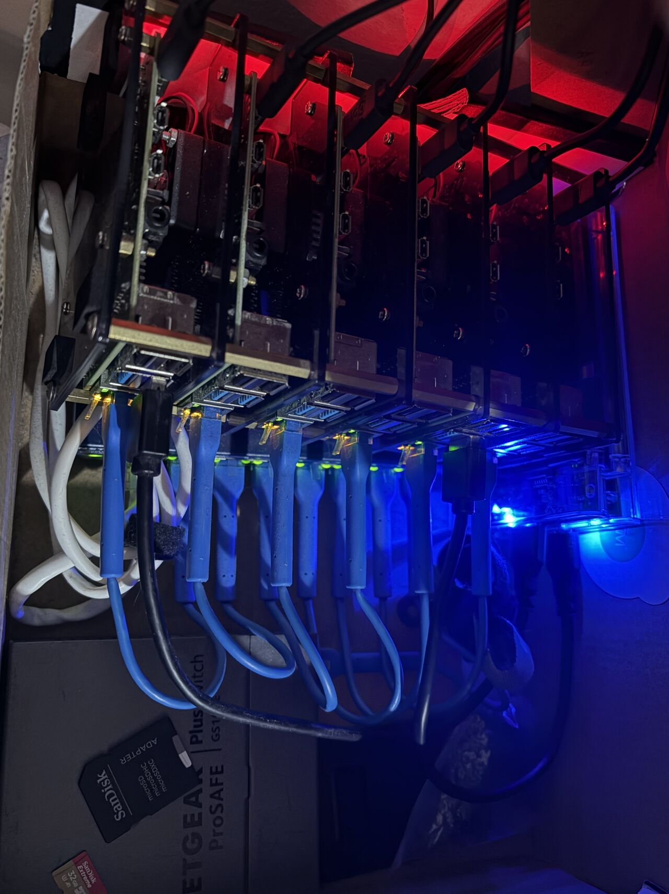

# Pi Cluster

Homelab K3s cluster on Raspberry Pis, automated with Ansible and FluxCD.



Fork of [ricsanfre/pi-cluster](https://github.com/ricsanfre/pi-cluster). Architecture, playbooks and Flux layout follow upstream; see the upstream documentation at https://picluster.ricsanfre.com for how each component works. This README covers only what differs here.

## Hardware and roles

| Host | IP | Role |
|---|---|---|
| gateway | 10.0.0.1 / 192.168.50.200 | OpenWrt router: firewall/NAT, DHCP, DNS forwarder, NTP ([metal/openwrt](metal/openwrt/README.md)) |
| pimaster | 192.168.50.100 / 10.0.0.20 | Ansible control node (VM on the shared home/cluster segment, see [pimaster](#pimaster-control-host)) |
| node1 | 10.0.0.11 | External services: bind9 (authoritative DNS), Vault, RustFS (S3) |
| node2–node4 | 10.0.0.12–14 | K3s control plane (embedded etcd). k3s API virtual IP 10.0.0.10 (kube-vip). node3 boots from a USB SSD and is a Longhorn storage node |
| node5 | 10.0.0.15 | K3s worker, boots from a USB SSD, Longhorn storage node |
| offsite | 10.99.0.2 (WireGuard) | Oracle Cloud VM (Always Free, Frankfurt): offsite backup copy, outside monitoring. See [Oracle Cloud](#oracle-cloud-offsite) |

IP plan (10.0.0.0/24): .1 gateway, .10 k3s API (kube-vip), .11-.19 nodes, .20 pimaster, .64/26 Cilium LoadBalancer pool (.68 Envoy gateway), .150-.249 DHCP.

Next: [Cluster 2.0](docs/plans/cluster-2.0.md), a highly available control plane on two Pi 4 8 GB nodes (node6, node7), every node on an SSD, Loki and Rancher.

DNS domain: `homelab.yekvitka.net` (Let's Encrypt certificates via IONOS DNS-01).

### Storage

- node1, node2 and node4 boot Ubuntu 24.04 from SD card. node3 and node5 boot from a USB SSD (bootloader default `BOOT_ORDER=0xf41` on node3: SD first, then USB, so it boots the SSD with no SD card inserted).
- node1 SSD: `/storage` for RustFS and Vault data (formatted by cloud-init, mounted by label `DATA`).
- Longhorn uses `/storage` on each node's own disk, created by cloud-init. It runs only on the SSD nodes, labeled `node_storage=longhorn` (node3: `k3s_longhorn_storage: true` in its host_vars; workers: `k3s_agent_config`). One replica per volume: no redundancy, Velero backs the volumes up daily.
- The USB-SATA adapters (Realtek RTL9201) time out with UAS under write load: UAS is disabled with `rpi_usb_storage_quirks` (`ansible/host_vars/node1.yml`, `node5.yml`). node3's adapter (Initio, `13fd:5917`) runs UAS without a quirk.

The centralized iSCSI SAN (node1 serving one LUN per k3s node) is disabled (`centralized_san: false`): Longhorn on iSCSI over a single USB SSD stalled the nodes. `ansible/configure_centralized_san.yml` and `ansible/vars/centralized_san/` are kept, not part of upstream.

## Differences from upstream

- 5 Raspberry Pis + OpenWrt gateway; no x86 nodes, no PXE server.
- BCM2835 hardware watchdog enabled on every Pi (`rpi_watchdog_sec`, basic_setup role): a hung node reboots itself.
- Optional centralized iSCSI SAN on node1, disabled (above).
- Ansible connects as `root`; SSH key from `metal/rpi/cloud-init/root.pub`.
- No Rancher (see Known limits).
- Web UIs on the Envoy gateway (10.0.0.68, wildcard Let's Encrypt certificate): Grafana (own login); Longhorn, Prometheus and Alertmanager behind basic auth (`SecurityPolicy` in the `route-basic-auth` components). The upstream route components use OIDC with Keycloak, which is not deployed. Credentials in Vault `secret/webui/basic-auth` (user `admin`), created by `make configure-webui-auth`: Envoy only accepts SHA htpasswd entries, so the playbook stores the password and the entry, External Secrets copies the entry into the cluster. Read the password with `vault kv get -field=password secret/webui/basic-auth`.
- k3s held on 1.36.x (`.github/renovate.json5`): Renovate proposes 1.36 patch releases only.
- Only core and monitoring platform apps are enabled in `kubernetes/clusters/prod/infra/kustomization.yaml`. The other upstream apps stay in `kubernetes/platform/` and can be re-enabled there.
- Sized for 4 GB Raspberry Pis with a single worker: node2 keeps the control plane `NoSchedule` taint (etcd only), node3 and node4 also run light, stateless workloads (`k3s_control_plane_taint: false` in their host_vars). Longhorn runs on the SSD nodes only (`node_storage=longhorn`: node3 and node5). Prometheus, Alertmanager and Grafana stay pinned to the worker (`node_type=worker`); their volumes have one replica, on node3 or node5. The kubelet reserves memory for k3s and the OS (`k3s_kubelet_config`: 1700Mi on the control plane, 600Mi on workers, plus 300Mi system) and evicts pods below 300Mi free. Logs (Loki, Fluentd, Fluent Bit) and traces (Tempo, OpenTelemetry collector) are disabled. One replica per service, no HA (CoreDNS included). Disabled as unused: descheduler (it packed evicted pods onto the emptiest node, which then ran out of memory), tofu-controller (Terraform runs from the runner), Hubble relay and UI (Hubble metrics stay). Velero backs up the cluster daily at 04:00 (30 days) to RustFS: resources to the `k3s-velero` bucket, Longhorn volumes as Longhorn backups to `k3s-longhorn`. k3s etcd snapshots (every 12h, last 5) are kept on each server and uploaded to the `k3s-etcd` bucket; k3s reads the S3 settings from the `kube-system/k3s-etcd-snapshot-s3-config` secret (External Secrets, Vault `s3/etcd`). Rancher is not used.

### Known limits (4 GB Raspberry Pis)

- Rancher does not fit. In the cluster its controllers exhaust the control plane nodes. Running Rancher on pimaster and importing the cluster failed too: the cattle-cluster-agent (500–700Mi) watches every resource type, which grew k3s-server by about 700Mi on each master and made node3 thrash. Removed (in-cluster app, Docker install on pimaster, import).
- Prometheus has a 700Mi memory limit (512Mi request), below node5's free memory: it is OOM-killed and restarted instead of hanging the node. In prod it keeps memory under the limit with a 60s scrape interval, 6h / 1GB retention and trimmed kubelet histograms (`app/overlays/prod/values.yaml`).

## Certificates

All Let's Encrypt certificates renew on their own (IONOS DNS-01, no open port):

| Certificate | Used by | Renewed by |
|---|---|---|
| `*.homelab.yekvitka.net` (`pi-cluster-tls`) | Grafana, Longhorn, Prometheus, Alertmanager (Envoy gateway) | cert-manager in the cluster |
| `vault.homelab.yekvitka.net` | Vault (node1) | certbot on node1, `systemctl reload vault` |
| `object-store.homelab.yekvitka.net` | RustFS S3 and console (node1) | certbot on node1, RustFS restart |
| `gateway.homelab.yekvitka.net` | OpenWrt LuCI | certbot on node1, pushed to the gateway |

`make configure-cert-renewal` (`ansible/cert_renewal.yml`) installs certbot (pinned, venv `/opt/certbot`) on node1 with the IONOS credentials, a daily `certbot-renew.timer` at 14:30 (outside the backup windows: a RustFS restart must not break a backup) and the deploy hook `/etc/letsencrypt/renewal-hooks/deploy/homelab-certs.sh`. certbot renews 30 days before expiry; the hook only reloads or restarts when the files changed. The LuCI certificate goes to the gateway with a node1 SSH key that dropbear restricts to `/etc/luci-cert/install.sh` (forced command, `metal/openwrt/script/luci-cert-receiver.sh`), so the IONOS key is not on the gateway. Gatus checks every certificate from outside and fails below 7 days left. The certbot steps of `deploy_vault.yml`, `deploy_rustfs.yml` and `make openwrt-certbot-tls` (certificates on the control host) are only needed for a first install.

## pimaster (control host)

Ubuntu 24.04 VM (6 GB memory, 6 CPUs), not managed by Ansible. The cluster LAN and the home network share one switch, so pimaster has an address on both and reaches the nodes directly, without the gateway route. Netplan replaces the installer config (cloud-init network config is disabled in `/etc/cloud/cloud.cfg.d/99-disable-network-config.cfg`):

```yaml
# /etc/netplan/50-cloud-init.yaml
network:
  version: 2
  renderer: networkd
  ethernets:
    enp0s1:
      dhcp4: false
      addresses:
      - 192.168.50.100/24
      - 10.0.0.20/24
      nameservers:
        addresses:
        - 10.0.0.1
        search:
        - homelab.yekvitka.net
      routes:
      - to: 0.0.0.0/0
        via: 192.168.50.1
        metric: 100
      - to: 0.0.0.0/0
        via: 10.0.0.1
        metric: 200
      - to: 10.99.0.0/24
        via: 10.0.0.1   # WireGuard tunnel to the Oracle VM
```

DNS comes only from the gateway, as on the nodes. The home router hands out its own IPv6 DNS servers, so a networkd drop-in ignores them:

```ini
# /etc/systemd/network/10-netplan-enp0s1.network.d/no-ipv6-dns.conf
[IPv6AcceptRA]
UseDNS=false
UseDomains=false

[DHCPv6]
UseDNS=false
UseDomains=false
```

Apply with `sudo netplan apply`, check with `resolvectl status enp0s1`.

Disk: 32 GB. The Ubuntu installer gives the root LV only half of the volume group. Extend it to the whole VG:

```shell
sudo lvextend -r -l +100%FREE /dev/ubuntu-vg/ubuntu-lv
```

## Build

1. Gateway: [metal/openwrt/README.md](metal/openwrt/README.md).
2. Boot disks (SD cards; USB SSDs for node3 and node5): put the pimaster user's public key (`/home/pimaster/.ssh/id_rsa.pub`, the key the ansible runner uses) in `metal/rpi/cloud-init/root.pub`, then from `metal/rpi`:

   ```shell
   make img/ubuntu-24.04.5-preinstalled-server-arm64+raspi.img.xz
   make burn-image USB=/dev/sdX
   export WIFI_SSID='<home ssid>' WIFI_KEY='<home wifi password>'   # wlan0 backup uplink
   make prepare-node1 USB=/dev/sdX SSD1_ID=<node1 SSD1 /dev/disk/by-id name>
   make prepare-node2 USB=/dev/sdX   # node3..node5 the same way
   ```

   Nodes get 10.0.0.1N on eth0 (DNS from the gateway) and 192.168.50.20N on wlan0.

3. Only with `centralized_san: true`: set node1 SSD2 in `ansible/vars/centralized_san/centralized_san_target.yml`.
4. From the repo root on pimaster:

   ```shell
   make prepare-ansible   # ansible runner + secret files (IONOS API key)
   make init              # os-upgrade, node setup, DNS, Vault/RustFS, SAN, k3s, Flux bootstrap
   ```

## Move a control plane node to SSD boot

pimaster is a VM without USB, so the SSD is flashed from the node itself while it still runs from its SD card. Done for node3; the cluster keeps etcd quorum (2 of 3) throughout.

1. Backups: `k3s etcd-snapshot save --name pre-<node>-ssd` on another server, and a Velero backup.
2. On the node: download the Ubuntu image and check it against `SHA256SUMS`, then `xz -dc  | dd of=/dev/disk/by-id/usb-<ssd> bs=4M conv=fsync`. Mount the SSD's `system-boot` partition and write `user-data` (from `metal/rpi/cloud-init/nodes/user-data`, `nodeX` and `SSH_PUB_KEY` replaced as in the Makefile) and `network-config` (a copy of the node's `/etc/netplan/50-cloud-init.yaml`: it keeps the Wi-Fi key on the node).
3. `kubectl drain <node> --ignore-daemonsets --delete-emptydir-data`, then `systemctl disable --now k3s` on the node, then `kubectl delete node <node>`. k3s removes the etcd member on node delete (`Removing etcd member from cluster due to node delete` in the other servers' k3s log).
4. Power off, remove the SD card (keep it: the rollback), power on. First boot grows the root partition and runs cloud-init.
5. From pimaster: `ssh-keygen -R <ip>`, also inside the runner (`docker exec ansible-runner ssh-keygen -f /home/runner/.ssh/known_hosts -R <ip>`), then with `--limit <node>`: `update.yml`, `setup_picluster.yml --tags node`, `k3s_install.yml`. The node joins as an etcd learner and is promoted.
6. system-upgrade-controller runs the `k3s-server` plan on the new node and cordons it until done. The upgrade script can fail with `Found multiple K3s pids` (it counts its own `k3s kubectl`); the Job retries and the node is uncordoned once the plan completes (`plan.upgrade.cattle.io/k3s-server` label).

Rollback before step 3: wipe the SSD. After step 3: unplug the SSD, insert the SD card (SD boots first), delete `/var/lib/rancher/k3s/server/db` on the node and rerun `k3s_install.yml --limit <node>`.

Changing `systemManagedComponentsNodeSelector` (Longhorn) is applied only with all Longhorn volumes detached: scale down Prometheus, Alertmanager and Grafana (suspend their Flux Kustomizations and HelmReleases first), let Flux upgrade Longhorn, then scale back up. Existing volumes keep their replica count: set `numberOfReplicas` on each `volumes.longhorn.io`.

## Oracle Cloud (offsite)

An Oracle Cloud Always Free VM (`terraform/oci`, region eu-frankfurt-1) keeps an offsite copy of the backups and monitors the cluster from outside. Ampere A1 (arm64): 1 OCPU, 6 GB, Ubuntu 24.04, 50 GB boot + 150 GB backup volume (ext4 `offsite-backups`, mounted at `/backup`). Free tier, not pay-as-you-go: Oracle may reclaim an idle VM.

- Access: the home public IP is dynamic (Play), so the VM opens no SSH to the internet. A WireGuard tunnel runs from the OpenWrt gateway (10.99.0.1) to the VM (10.99.0.2): the gateway connects out and keeps it up, no port forwarding at home. Oracle security list: UDP 51820 and ICMP 3/4 only (the VCN default list is emptied). On the VM, iptables allows SSH on `wg0` only.
- Gateway side: `metal/openwrt/script/wireguard-oci.sh`, firewall zone `oci` (nothing from the VM into home networks).
- Secrets on the control host, not in Git: `~/.secrets/oci/` (API key and config), `~/.secrets/wireguard/oci-vm.key`. OCIDs and keys paths in `terraform/oci/terraform.tfvars` (gitignored, see `terraform.tfvars.example`).
- Offsite backup (`make configure-offsite-backup`, `ansible/offsite_backup.yml`): every night at 05:00 node1 copies `/storage/rustfs` (all RustFS buckets: Longhorn, Velero, etcd snapshots, node restic) and a Vault Raft snapshot (`/var/backups/vault/vault.snap`) to the VM with restic over SFTP (`restic-offsite.timer`). Encrypted on node1, the VM never gets the password. Retention 7 daily, 4 weekly, 6 monthly (grouped by host and tag). On the VM the `restic` user is SFTP-only, chrooted to `/backup`. The repository password is `~/.secrets/restic-offsite.password` on the control host: keep a copy in a password manager, the offsite copy cannot be read without it. Vault is copied as a Raft snapshot, never as files (`/storage/vault` is live Raft storage): `vault-raft-snapshot.sh` runs before restic with a periodic orphan token that only has the `raft-snapshot` policy (`terraform/vault`), stored in `/etc/restic/vault-snapshot.token` and renewed by every snapshot. A failed snapshot does not stop the RustFS copy. Restore check: `vault operator raft snapshot inspect <file>`.
- Outside monitoring (`make configure-offsite-monitoring`, `ansible/offsite_monitoring.yml`): Gatus on the VM checks Grafana, the k3s API, Vault, RustFS, LuCI and bind9 through the tunnel, plus certificate expiry (alert below 7 days). UI on http://10.99.0.2:8080 (tunnel only: from pimaster, or from the home network with the route through the gateway). The gateway allows only these targets from the VM. No notifications yet.
- The first-boot config (`cloud-init.yaml.tftpl`) runs once: Terraform ignores later changes to it and to the image, configure the running VM over SSH.

```shell
./ansible-runner/ansible-runner.sh bash -lc 'cd /terraform/oci && tofu plan'
ssh ubuntu@10.99.0.2      # from pimaster or the home network (route 10.99.0.0/24 via the gateway)
```

From a home network machine (192.168.50.x), add the route through the gateway first, e.g. on macOS: `sudo route -n add -net 10.99.0.0/24 192.168.50.200`.

## License

MIT, see [LICENSE](LICENSE). Original work © ricsanfre.
