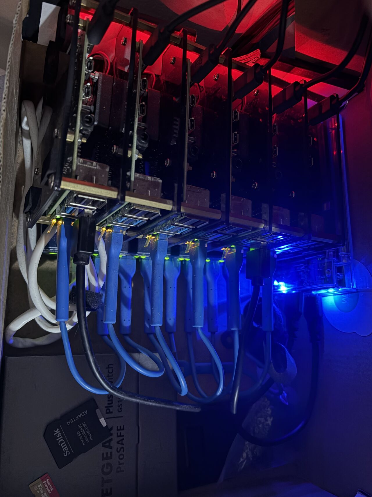

# Pi Cluster

Homelab K3s cluster on Raspberry Pis, automated with Ansible and FluxCD.



Fork of [ricsanfre/pi-cluster](https://github.com/ricsanfre/pi-cluster). Architecture, playbooks and Flux layout follow upstream; see the upstream documentation at https://picluster.ricsanfre.com for how each component works. This README covers only what differs here.

## Hardware and roles

| Host | IP | Role |
|---|---|---|
| gateway | 10.0.0.1 / 192.168.50.200 | OpenWrt router: firewall/NAT, DHCP, DNS forwarder, NTP ([metal/openwrt](metal/openwrt/README.md)) |
| pimaster | 192.168.50.100 / 10.0.0.16 | Ansible control node and Rancher server (VM on the shared home/cluster segment, see [pimaster](#pimaster-control-host)) |
| node1 | 10.0.0.11 | External services: bind9 (authoritative DNS), Vault, RustFS (S3) |
| node2–node4 | 10.0.0.12–14 | K3s control plane (embedded etcd). k3s API virtual IP 10.0.0.10 (kube-vip). node3 boots from a USB SSD and is a Longhorn storage node |
| node5 | 10.0.0.15 | K3s worker, boots from a USB SSD, Longhorn storage node |

DNS domain: `homelab.yekvitka.net` (Let's Encrypt certificates via IONOS DNS-01).

### Storage

- node1, node2 and node4 boot Ubuntu 24.04 from SD card. node3 and node5 boot from a USB SSD (bootloader default `BOOT_ORDER=0xf41` on node3: SD first, then USB, so it boots the SSD with no SD card inserted).
- node1 SSD: `/storage` for RustFS and Vault data (formatted by cloud-init, mounted by label `DATA`).
- Longhorn uses `/storage` on each node's own disk, created by cloud-init. It runs only on the SSD nodes, labeled `node_storage=longhorn` (node3: `k3s_longhorn_storage: true` in its host_vars; workers: `k3s_agent_config`). Two replicas per volume, one on node3 and one on node5.
- The USB-SATA adapters (Realtek RTL9201) time out with UAS under write load: UAS is disabled with `rpi_usb_storage_quirks` (`ansible/host_vars/node1.yml`, `node5.yml`). node3's adapter (Initio, `13fd:5917`) runs UAS without a quirk.

The centralized iSCSI SAN (node1 serving one LUN per k3s node) is disabled (`centralized_san: false`): Longhorn on iSCSI over a single USB SSD stalled the nodes. `ansible/configure_centralized_san.yml` and `ansible/vars/centralized_san/` are kept, not part of upstream.

## Differences from upstream

- 5 Raspberry Pis + OpenWrt gateway; no x86 nodes, no PXE server.
- BCM2835 hardware watchdog enabled on every Pi (`rpi_watchdog_sec`, basic_setup role): a hung node reboots itself.
- Optional centralized iSCSI SAN on node1, disabled (above).
- Ansible connects as `root`; SSH key from `metal/rpi/cloud-init/root.pub`.
- Rancher runs on pimaster in Docker (`rancher/docker-compose.yaml`) and manages the cluster as an imported cluster, see [Rancher](#rancher). The in-cluster Flux app (`kubernetes/platform/rancher`) is kept, not enabled in prod (see Known limits).
- k3s held on 1.36.x: Rancher 2.15 supports Kubernetes < 1.37 (`.github/renovate.json5`).
- Only core and monitoring platform apps are enabled in `kubernetes/clusters/prod/infra/kustomization.yaml`. The other upstream apps stay in `kubernetes/platform/` and can be re-enabled there.
- Sized for 4 GB Raspberry Pis with a single worker: node2 keeps the control plane `NoSchedule` taint (etcd only), node3 and node4 also run light, stateless workloads (`k3s_control_plane_taint: false` in their host_vars). Longhorn runs on the SSD nodes only (`node_storage=longhorn`: node3 and node5). Prometheus, Alertmanager and Grafana stay pinned to the worker (`node_type=worker`) and keep a second replica of their volumes on node3. The kubelet reserves memory for k3s and the OS (`k3s_kubelet_config`: 1700Mi on the control plane, 600Mi on workers, plus 300Mi system) and evicts pods below 300Mi free. Logs (Loki, Fluentd, Fluent Bit) and traces (Tempo, OpenTelemetry collector) are disabled. Velero backs up the cluster daily at 04:00 (30 days) to RustFS: resources to the `k3s-velero` bucket, Longhorn volumes as Longhorn backups to `k3s-longhorn`. k3s etcd snapshots (every 12h, last 5) are kept on each server and uploaded to the `k3s-etcd` bucket; k3s reads the S3 settings from the `kube-system/k3s-etcd-snapshot-s3-config` secret (External Secrets, Vault `s3/etcd`). Rancher runs outside the cluster, on pimaster.

### Known limits (4 GB Raspberry Pis)

- Rancher deploys its own controllers (Fleet, CAPI, Turtles, webhook, system-upgrade-controller) with tolerations for the control plane taint. On 4 GB control plane nodes with etcd on SD cards this exhausts them, so `rancher-app` is removed from `kubernetes/clusters/prod/infra/kustomization.yaml` and Rancher runs on pimaster instead (an SSD does not help: memory is the limit). Its files stay in `kubernetes/platform/rancher` (bundled catalogs, 10 minute startup probe, 1200Mi limit).
- Prometheus has a 700Mi memory limit (512Mi request), below node5's free memory: it is OOM-killed and restarted instead of hanging the node. In prod it keeps memory under the limit with a 60s scrape interval, 6h / 1GB retention and trimmed kubelet histograms (`app/overlays/prod/values.yaml`).

## pimaster (control host)

Ubuntu 24.04 VM (6 GB memory, 6 CPUs: Rancher has a 4 GB memory limit), not managed by Ansible. The cluster LAN and the home network share one switch, so pimaster has an address on both and reaches the nodes directly, without the gateway route. Netplan replaces the installer config (cloud-init network config is disabled in `/etc/cloud/cloud.cfg.d/99-disable-network-config.cfg`):

```yaml
# /etc/netplan/50-cloud-init.yaml
network:
  version: 2
  renderer: networkd
  ethernets:
    enp0s1:
      dhcp4: false
      addresses:
      - 192.168.50.100/24
      - 10.0.0.16/24
      nameservers:
        addresses:
        - 10.0.0.1
        search:
        - homelab.yekvitka.net
      routes:
      - to: 0.0.0.0/0
        via: 192.168.50.1
        metric: 100
      - to: 0.0.0.0/0
        via: 10.0.0.1
        metric: 200
```

DNS comes only from the gateway, as on the nodes. The home router hands out its own IPv6 DNS servers, so a networkd drop-in ignores them:

```ini
# /etc/systemd/network/10-netplan-enp0s1.network.d/no-ipv6-dns.conf
[IPv6AcceptRA]
UseDNS=false
UseDomains=false

[DHCPv6]
UseDNS=false
UseDomains=false
```

Apply with `sudo netplan apply`, check with `resolvectl status enp0s1`.

Disk: 32 GB. The Ubuntu installer gives the root LV only half of the volume group. Extend it to the whole VG:

```shell
sudo lvextend -r -l +100%FREE /dev/ubuntu-vg/ubuntu-lv
```

## Build

1. Gateway: [metal/openwrt/README.md](metal/openwrt/README.md).
2. Boot disks (SD cards; USB SSDs for node3 and node5): put the pimaster user's public key (`/home/pimaster/.ssh/id_rsa.pub`, the key the ansible runner uses) in `metal/rpi/cloud-init/root.pub`, then from `metal/rpi`:

   ```shell
   make img/ubuntu-24.04.5-preinstalled-server-arm64+raspi.img.xz
   make burn-image USB=/dev/sdX
   export WIFI_SSID='<home ssid>' WIFI_KEY='<home wifi password>'   # wlan0 backup uplink
   make prepare-node1 USB=/dev/sdX SSD1_ID=<node1 SSD1 /dev/disk/by-id name>
   make prepare-node2 USB=/dev/sdX   # node3..node5 the same way
   ```

   Nodes get 10.0.0.1N on eth0 (DNS from the gateway) and 192.168.50.20N on wlan0.

3. Only with `centralized_san: true`: set node1 SSD2 in `ansible/vars/centralized_san/centralized_san_target.yml`.
4. From the repo root on pimaster:

   ```shell
   make prepare-ansible   # ansible runner + secret files (IONOS API key)
   make init              # os-upgrade, node setup, DNS, Vault/RustFS, SAN, k3s, Flux bootstrap
   ```

## Rancher

Rancher 2.15 runs on pimaster in Docker (`rancher/docker-compose.yaml`, 4 GB memory limit), at https://rancher.homelab.yekvitka.net. The Pis only run its agents: the cluster is imported.

- Certificate: Let's Encrypt via certbot DNS-01 in the runner (`make rancher-cert`, `ansible/rancher_certificate.yml`), mounted into the container. Rerun `make rancher-cert` to renew, then `make rancher-up`.
- DNS: `rancher` A record to 10.0.0.16, a `DNSEndpoint` published by external-dns (`kubernetes/platform/external-dns/config`).
- Settings in the compose file (`CATTLE_<SETTING>`, read-only in the UI): server URL; `agent-tls-mode: system-store` (public CA); `imported-cluster-version-management: false`, so k3s upgrades stay with system-upgrade-controller and Rancher does not install its own.
- Data in the `rancher_rancher-data` Docker volume (Docker is the snap package: it cannot bind-mount paths outside `/home`). Not covered by Velero or the node backups.
- Imported cluster `pi-cluster`: cattle-cluster-agent limited to 512Mi (128Mi request) and preferring node2, fleet-agent to 256Mi (`clusterAgentDeploymentCustomization` / `fleetAgentDeploymentCustomization` on the Rancher `Cluster`).

```shell
sudo -u pimaster make rancher-up   # start / restart (compose uses pimaster's $HOME)
docker exec rancher kubectl -n cattle-system get secret bootstrap-secret -o go-template='{{ .data.bootstrapPassword | base64decode }}{{ "\n" }}'   # first login (user admin)
```

## Move a control plane node to SSD boot

pimaster is a VM without USB, so the SSD is flashed from the node itself while it still runs from its SD card. Done for node3; the cluster keeps etcd quorum (2 of 3) throughout.

1. Backups: `k3s etcd-snapshot save --name pre-<node>-ssd` on another server, and a Velero backup.
2. On the node: download the Ubuntu image and check it against `SHA256SUMS`, then `xz -dc  | dd of=/dev/disk/by-id/usb-<ssd> bs=4M conv=fsync`. Mount the SSD's `system-boot` partition and write `user-data` (from `metal/rpi/cloud-init/nodes/user-data`, `nodeX` and `SSH_PUB_KEY` replaced as in the Makefile) and `network-config` (a copy of the node's `/etc/netplan/50-cloud-init.yaml`: it keeps the Wi-Fi key on the node).
3. `kubectl drain <node> --ignore-daemonsets --delete-emptydir-data`, then `systemctl disable --now k3s` on the node, then `kubectl delete node <node>`. k3s removes the etcd member on node delete (`Removing etcd member from cluster due to node delete` in the other servers' k3s log).
4. Power off, remove the SD card (keep it: the rollback), power on. First boot grows the root partition and runs cloud-init.
5. From pimaster: `ssh-keygen -R <ip>`, also inside the runner (`docker exec ansible-runner ssh-keygen -f /home/runner/.ssh/known_hosts -R <ip>`), then with `--limit <node>`: `update.yml`, `setup_picluster.yml --tags node`, `k3s_install.yml`. The node joins as an etcd learner and is promoted.
6. system-upgrade-controller runs the `k3s-server` plan on the new node and cordons it until done. The upgrade script can fail with `Found multiple K3s pids` (it counts its own `k3s kubectl`); the Job retries and the node is uncordoned once the plan completes (`plan.upgrade.cattle.io/k3s-server` label).

Rollback before step 3: wipe the SSD. After step 3: unplug the SSD, insert the SD card (SD boots first), delete `/var/lib/rancher/k3s/server/db` on the node and rerun `k3s_install.yml --limit <node>`.

Changing `systemManagedComponentsNodeSelector` (Longhorn) is applied only with all Longhorn volumes detached: scale down Prometheus, Alertmanager and Grafana (suspend their Flux Kustomizations and HelmReleases first), let Flux upgrade Longhorn, then scale back up. Existing volumes keep their replica count: set `numberOfReplicas` on each `volumes.longhorn.io`.

## License

MIT, see [LICENSE](LICENSE). Original work © ricsanfre.
